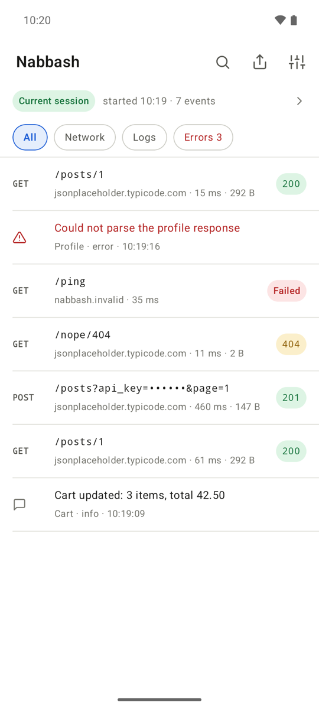
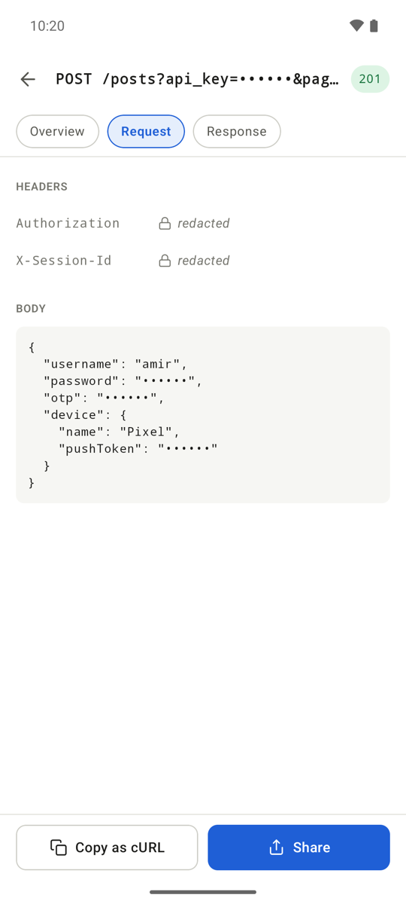
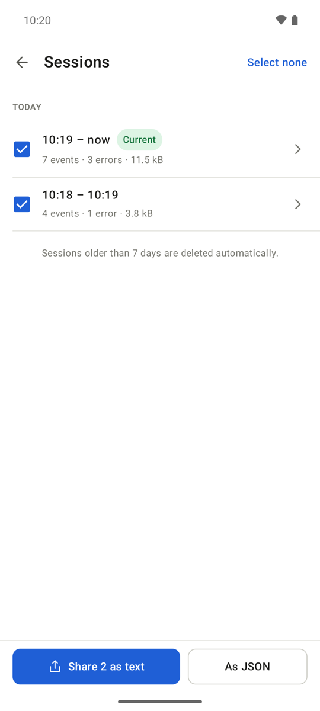
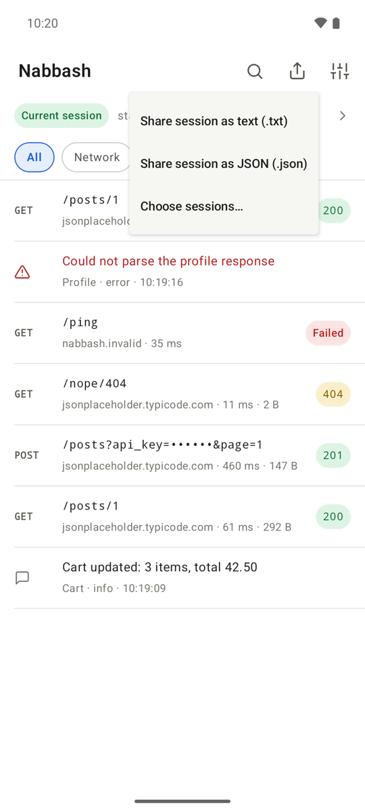
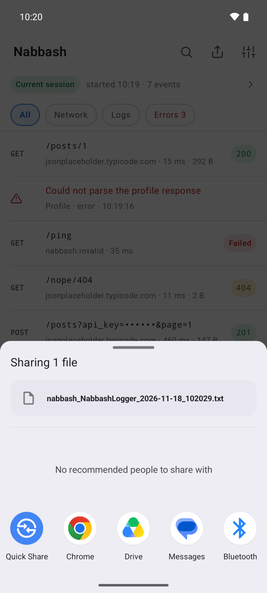
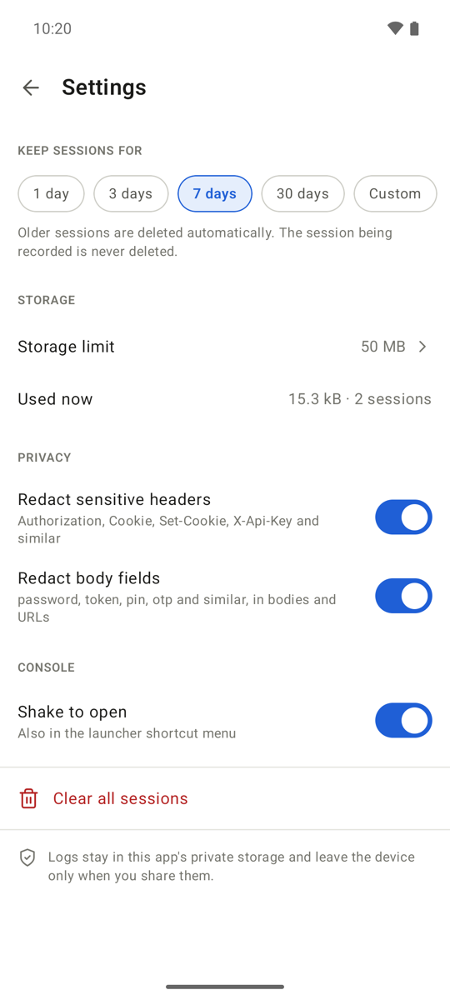

# Nabbash

A network and log console for Android debug builds. It records your app's HTTP calls and log
messages on the device, shows them in a built-in console, and lets you share the current
session or earlier ones as a file. It is the Android counterpart of `PulseLogger.swift`.

- **Debug only.** Release builds get an empty stand-in with the same API: no console, no storage, no recording.
- **Secrets are masked before anything is written to disk.**
- **Nothing to initialise.** Add the dependency and it runs.

Requires Android 7.0 (API 24) or newer. OkHttp is optional.

## Screenshots

<table>
  <tr>
    <td align="center"></td>
    <td align="center"></td>
    <td align="center"></td>
  </tr>
  <tr>
    <td align="center"><b>Console</b><br>Every call and log of the current session, with filters and search.</td>
    <td align="center"><b>Request detail</b><br>Secrets are masked before they are stored.</td>
    <td align="center"><b>Sessions</b><br>Open or share the current session and earlier ones.</td>
  </tr>
  <tr>
    <td align="center"></td>
    <td align="center"></td>
    <td align="center"></td>
  </tr>
  <tr>
    <td align="center"><b>Share</b><br>As text for people or JSON for tools.</td>
    <td align="center"><b>Share sheet</b><br>Send the file to Slack, email, Drive or anywhere else.</td>
    <td align="center"><b>Settings</b><br>How long sessions are kept, storage limit, masking.</td>
  </tr>
</table>

## Setup

### 1. Add the dependency

Add JitPack to your repositories:

```kotlin
// settings.gradle.kts
dependencyResolutionManagement {
    repositories {
        google()
        mavenCentral()
        maven("https://jitpack.io")
    }
}
```

Then add both artifacts:

```kotlin
// app/build.gradle.kts
dependencies {
    debugImplementation("com.github.AmirZregat.NabbashLogger:nabbash:1.0.0")
    releaseImplementation("com.github.AmirZregat.NabbashLogger:nabbash-no-op:1.0.0")
}
```

Both lines are needed. The second one is what keeps your release build compiling while
containing none of Nabbash. If you have more build types, give every non-debuggable one the
`nabbash-no-op` artifact.

### 2. Record network calls

With OkHttp or Retrofit, add the interceptor:

```kotlin
val client = OkHttpClient.Builder()
    .addInterceptor(NabbashInterceptor())
    .build()
```

That is the whole setup. Run a debug build, make a few calls, then **shake the device** (or
long-press the app icon and choose **Open Nabbash**).

## Logging

```kotlin
Nabbash.log("Cart updated: 3 items", label = "Cart", level = NabbashLevel.INFO)
Nabbash.log("Could not parse the profile", label = "Profile", level = NabbashLevel.ERROR, throwable = e)
```

For an HTTP client other than OkHttp, report calls yourself:

```kotlin
Nabbash.logNetwork(
    method = "POST",
    url = "https://api.example.com/v1/login",
    statusCode = 200,
    requestHeaders = mapOf("Content-Type" to "application/json"),
    requestBody = requestJson,
    responseHeaders = responseHeaders,
    responseBody = responseJson,
    durationMs = 412,
    error = null,
)
```

Other entry points:

| Call | What it does |
| --- | --- |
| `Nabbash.open(context)` | Opens the console, for example from your own debug menu. |
| `Nabbash.isEnabled` | `true` only in a debuggable build with the real artifact. |

Every call is safe in release builds: there it does nothing. From Java, use
`Nabbash.log("…")`, `Nabbash.open(context)` and so on; the methods are static.

## Configuration

Optional. Call it once, usually in `Application.onCreate`:

```kotlin
Nabbash.configure {
    sessionRetention = 7.days      // how long finished sessions are kept (1 hour to 365 days)
    maxStorageMb = 50              // oldest sessions are deleted first when this is exceeded
    maxBodyBytes = 250_000         // longer request and response bodies are cut
    shakeToOpen = true
    launcherShortcut = true
    redactHeaders += "X-Session-Id"   // masked in addition to the built-in list
    redactBodyKeys += "nationalId"    // also matches national_id, NationalID, …
}
```

| Option | Default | Notes |
| --- | --- | --- |
| `sessionRetention` | `7.days` | A session is one launch of the app. A finished session is deleted once its last event is older than this. The session being recorded is never deleted. |
| `maxStorageMb` | `50` | Total size of stored logs. |
| `maxBodyBytes` | `250_000` | Per body. Binary, multipart and streaming bodies are never stored; a short description is stored instead. |
| `shakeToOpen` | `true` | |
| `launcherShortcut` | `true` | Adds **Open Nabbash** to the app icon's long-press menu. |
| `redactHeaders` | empty | Extra header names to mask. |
| `redactBodyKeys` | empty | Extra field names to mask in JSON, form and XML bodies and in URLs. |

Retention, the storage limit, shake to open and the two redaction switches can also be changed
on the device in the console's **Settings** screen. A choice made there wins over the code.

## Sessions and sharing

Each app launch starts a new session. The console opens on the current one; tap the session
strip at the top to see earlier sessions, open one, or select several.

| From | You can share |
| --- | --- |
| Console toolbar | The session on screen, as text or as JSON |
| Sessions screen | Any selection of sessions, **as text** or **as JSON** |
| Event detail | One request or log entry as text, or **Copy as cURL** |

Sharing goes through the Android share sheet, so the file can go to Slack, email, Drive, or
anywhere else.

- **`.txt`** is made for reading: a header with app, device and export time, then every session with its events, headers and pretty-printed bodies.
- **`.json`** is made for tools. Top-level fields: `generator`, `formatVersion`, `exportedAt`, `app`, `device`, `redactedValue`, `sessions[]`. Each session has `id`, `current`, `startedAt`, `lastEventAt`, `appVersion` and `events[]`; a network event has `method`, `url`, `status`, `durationMs`, `request` and `response` (`headers[]`, `body`, `sizeBytes`) and `error`; a log event has `level`, `label`, `message` and `stackTrace`.

Files are named `nabbash_<app>_<date>_<time>.txt` or `.json`.

## Security

**Debug builds only**

- The real library is only ever on the `debugImplementation` classpath. A release build made with the setup above contains four empty classes and nothing else from Nabbash: no activity, no provider, no resources, no storage code.
- As a second line of defence, the real library checks `FLAG_DEBUGGABLE` when the process starts. If it finds itself in a non-debuggable build it stays off and deletes anything an earlier debug install left behind.

**Secrets are masked before they are stored**, so they are never on disk, on screen or in an export:

- Headers: `Authorization`, `Proxy-Authorization`, `Cookie`, `Set-Cookie`, API key and auth token headers, plus your `redactHeaders`.
- Fields named like a password, token, secret, API key, OTP, PIN, CVV, card number or session id, plus your `redactBodyKeys`, in JSON (including nested and string-escaped JSON), form bodies and XML.
- The same field names in URL query strings, and in any `key=value` text inside header values, log messages, stack traces and error descriptions.
- `Bearer …` and `Basic …` credentials anywhere in text.
- `user:password@` in URLs. This is always removed, even with redaction switched off.

Masked values appear as `••••••`. Masking works on names and patterns: a secret in a field with
an unrelated name, or pasted into a log message as bare text, is not recognised. Add your own
names with `redactHeaders` and `redactBodyKeys`, and look over an export before sending it
outside your team.

**Storage and access**

- Logs live in the app's private no-backup directory, so they are excluded from cloud backup and device transfer. Deleted rows are overwritten (`secure_delete`).
- The console activity and both content providers are not exported: other apps cannot open the console or read the logs.
- A shared file is exposed through a one-time, read-only grant to the app you pick, limited to the export folder. Export files are deleted on the next launch, on **Clear all sessions**, and after ten minutes.
- Text copied from the console is flagged as sensitive, so Android hides it in the clipboard preview.
- Nabbash has no network code of its own and requests no permissions. Logs leave the device only when you share them.
- The interceptor never changes a request or response and never lets its own failure break a call.

**Limits to know about**

- A debuggable app can be read with `adb` (`run-as`) by anyone holding the unlocked device with USB debugging on. That is true of all of a debug build's data, not only Nabbash's. Do not hand out debug builds pointed at production accounts.
- Recording happens in the app's main process only. Other processes (`android:process`) are not recorded.
- Add `NabbashInterceptor()` with `addInterceptor`, as shown. Headers that OkHttp adds on its own later (`Content-Type`, `User-Agent`, cookies from a cookie jar) are then not listed for the request.

## Getting the artifacts

**From JitPack** (the setup above): JitPack builds each tagged release of this repository on
first request. `jitpack.yml` tells it to build both artifacts with JDK 17. Build logs are at
`https://jitpack.io/#AmirZregat/NabbashLogger`.

**From a local build**, for trying out changes to the library itself:

```bash
./gradlew :nabbash:publishToMavenLocal :nabbash-no-op:publishToMavenLocal
```

Then add `mavenLocal()` to the consuming project's repositories in `settings.gradle.kts` and use
`com.amirzregat.nabbash:nabbash:1.0.0` and `com.amirzregat.nabbash:nabbash-no-op:1.0.0`.

## Project layout

| Module | Purpose |
| --- | --- |
| `nabbash` | The library: recording, storage, redaction, console, sharing. |
| `nabbash-no-op` | Same public API with empty bodies, for release builds. |
| `app` | Sample app with buttons that produce every kind of event. |

## Tests

```bash
./gradlew :nabbash:testDebugUnitTest
```

```bash
./gradlew :nabbash:connectedDebugAndroidTest
```

The first covers redaction, HTTP capture and the export formats on the JVM. The second needs a
device or emulator and covers storage: retention, the storage limit, clearing and search.

## License

Copyright 2026 Amir Zregat. Licensed under the [Apache License, Version 2.0](LICENSE).
